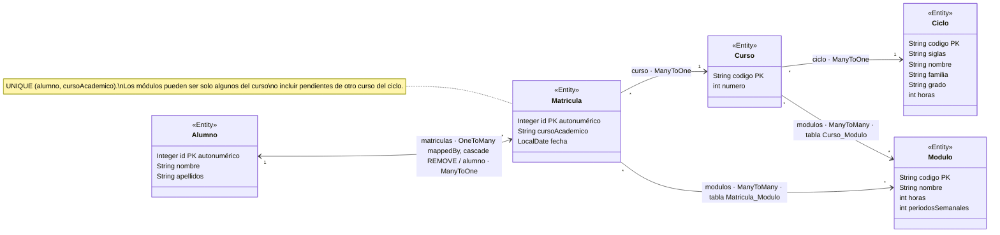

# Instituto · Ejemplo de JPA (UD3 · Acceso a Datos · DAM2)

Pequeña aplicación de consola que gestiona los **alumnos** de un instituto con las
operaciones CRUD básicas (*Create, Read, Update, Delete*) usando el **estándar JPA**
(Jakarta Persistence). Hibernate actúa como *proveedor* de JPA y SQLite como base de datos.

> Objetivo didáctico: trabajar con objetos Java y dejar que JPA se encargue de
> traducirlos a SQL, sin escribir ni una sola sentencia `INSERT`, `UPDATE` o `DELETE`.

---

## 1. Estructura del proyecto

```
src/main/java/com/example/instituto/
├── Main.java                 → Menú de consola con JPA puro (interfaz con el usuario)
├── InstitutoApplication.java → La misma aplicación con Spring Data JPA (apartado 9)
├── model/                    → Entidades JPA
│   ├── Alumno.java
│   ├── Ciclo.java
│   ├── Curso.java
│   ├── Matricula.java
│   └── Modulo.java
├── dao/                      → Acceso a datos con JPA puro
│   ├── AlumnoDao.java        → CRUD de alumnos
│   ├── CursoDao.java         → Consultas de cursos
│   ├── MatriculaDao.java     → Matricular, consultar y anular matrículas
│   └── ModuloDao.java        → Consultas de módulos
├── repository/               → Acceso a datos con Spring Data
│   ├── AlumnoRepository.java
│   ├── CursoRepository.java
│   └── MatriculaRepository.java
└── datos/
    └── DatosIniciales.java   → Precarga de ciclos, cursos, módulos y alumnos de ejemplo

src/main/resources/
├── META-INF/persistence.xml  → Configuración de JPA (unidad de persistencia)
└── application.properties    → Configuración de Spring Boot

docs/modelo.puml              → Diagrama de clases del modelo (PlantUML)
docs/modelo.mmd               → El mismo diagrama en Mermaid
docs/modelo.html              → Página interactiva: diagrama + explicación (abrir en el navegador)
instituto.db                  → Base de datos SQLite
```

Cada clase tiene una única responsabilidad:

| Capa        | Clase         | Responsabilidad                                       |
|-------------|---------------|-------------------------------------------------------|
| Modelo      | `Alumno`, `Curso`… | Representa los datos (una fila de la tabla)      |
| Acceso a datos | `AlumnoDao`… | Sabe *cómo* guardar, buscar, modificar y borrar     |
| Presentación | `Main`       | Pide datos al usuario y muestra resultados            |

`Main` no sabe nada de SQL ni de transacciones; `AlumnoDao` no sabe nada de la consola.
Este es el patrón **DAO** (*Data Access Object*).

---

## 2. Conceptos clave de JPA

| Concepto | Qué es | Dónde aparece |
|----------|--------|---------------|
| **Entidad** | Clase Java cuyos objetos se guardan en la BD | `Alumno` (`@Entity`) |
| **Unidad de persistencia** | Configuración con nombre: BD, entidades, opciones | `persistence.xml` → `institutoPU` |
| **`EntityManagerFactory`** | Fábrica de `EntityManager`. Costosa de crear: **una por aplicación** | `Main` |
| **`EntityManager`** | Objeto con el que trabajamos: guarda, busca, borra… **Uno por operación** | `AlumnoDao` |
| **`EntityTransaction`** | Agrupa cambios: o se aplican todos (`commit`) o ninguno (`rollback`) | `AlumnoDao` |
| **JPQL** | Lenguaje de consultas parecido a SQL, pero sobre **clases y atributos**, no tablas y columnas | `listarTodos`, `listarPorCurso` |

---

## 3. La entidad `Alumno`

```java
@Entity
public class Alumno {
    @Id
    @GeneratedValue(strategy = GenerationType.IDENTITY)
    private Integer id;
    private String nombre;
    private String apellidos;

    @OneToMany(mappedBy = "alumno", cascade = CascadeType.REMOVE)
    private List<Matricula> matriculas = new ArrayList<>();   // ver apartado 4

    public Alumno() { }   // obligatorio para JPA
    ...
}
```

- `@Entity` → la clase se corresponde con la tabla `Alumno`.
- `@Id` → clave primaria.
- `@GeneratedValue(IDENTITY)` → el id lo genera la base de datos (autoincremento).
  Por eso al crear un alumno **no** se indica el id: JPA lo rellena tras el `persist`.
- Cada atributo se convierte en una columna con el mismo nombre.
- JPA necesita un **constructor sin parámetros** para crear los objetos al leer de la BD.

La tabla **no** se crea a mano: JPA la genera (o la actualiza) al arrancar gracias a
la propiedad `schema-generation` de `persistence.xml`.

---

## 4. Relaciones entre entidades: ciclos, cursos, módulos y matrículas

### El modelo

El diagrama de clases está disponible en varios formatos. Para estudiarlo, lo más
cómodo es abrir [`docs/modelo.html`](docs/modelo.html) en el navegador: incluye el
diagrama interactivo, cómo leerlo, las tablas que genera JPA y preguntas de repaso.

- **PlantUML:** [`docs/modelo.puml`](docs/modelo.puml). Se puede ver con la extensión
  *PlantUML* de VS Code / IntelliJ, en [plantuml.com](https://www.plantuml.com/plantuml)
  o generando la imagen con `plantuml -tsvg docs/modelo.puml`.
- **Mermaid:** [`docs/modelo.mmd`](docs/modelo.mmd). Se puede ver en
  [mermaid.live](https://mermaid.live), en VS Code con la extensión
  *Markdown Preview Mermaid Support*, y GitHub/GitLab lo dibujan directamente
  dentro de un fichero Markdown, como aquí:



Resumido en texto:

```
   ┌──────────┐ 1     N ┌──────────┐ N     M ┌──────────┐
   │  Ciclo   │◀────────│  Curso   │────────▶│  Modulo  │
   │ (DAM)    │         │ (DAM2)   │         │ (MP0486) │
   └──────────┘         └──────────┘         └──────────┘
                          1 ▲                     ▲ M
                            │                     │
                          N │                     │ N
   ┌──────────┐ 1     N ┌───┴──────────────────────┴─┐
   │  Alumno  │◀───────▶│        Matricula           │
   │          │         │ (Uxía, 2026-2027, DAM2)    │
   └──────────┘         └────────────────────────────┘
```

Una **matrícula** une a un alumno con un **curso académico** (`2026-2027`): indica el
curso en el que se matricula (DAM2) y los **módulos** concretos que cursa. Así se
pueden representar los casos reales:

| Caso | Ejemplo en los datos precargados |
|------|----------------------------------|
| Curso completo | Antía: ASIR2 completo en 2026-2027 |
| Solo algunos módulos | Brais: DAW1 con Programación, Bases de datos y LMSXI |
| Curso + pendientes | Uxía: DAM2 completo + *Bases de datos* (MP0484) pendiente de DAM1 |
| Historial de años | Uxía: también tiene la matrícula de DAM1 de 2025-2026 |

Por eso `Alumno` **no** tiene un atributo `curso`: el curso depende del año y lo
indica cada matrícula.

| Entidad | Clave primaria | Atributos | Ejemplo |
|---------|----------------|-----------|---------|
| `Ciclo` | `codigo` | siglas, nombre, familia, grado, horas | `D3IFC000200`, DAM, Desenvolvemento de aplicacións multiplataforma, superior, 2000 h |
| `Curso` | `codigo` | numero, ciclo, modulos | `DAM2`, 2, → DAM, → 10 módulos |
| `Modulo` | `codigo` | nombre, horas, periodosSemanales | `MP0486`, Acceso a datos, 220 h, 8 |
| `Alumno` | `id` (autonumérico) | nombre, apellidos, matriculas | 5, Uxía, Castro Varela, → 2 matrículas |
| `Matricula` | `id` (autonumérico) | alumno, cursoAcademico, curso, fecha, modulos | 2, → Uxía, 2026-2027, → DAM2, 09/09/2026, → 11 módulos |

En `Ciclo`, `Curso` y `Modulo` la clave primaria es **natural**: un código que ya existe
en la realidad, y por eso no lleva `@GeneratedValue`.

Los datos se han tomado de la web de FP de la Xunta de Galicia
([ASIR](https://www.edu.xunta.gal/fp/ciclo/D3IFC000100),
[DAM](https://www.edu.xunta.gal/fp/ciclo/D3IFC000200),
[DAW](https://www.edu.xunta.gal/fp/ciclo/D3IFC000300)): 3 ciclos, 6 cursos y 33
módulos distintos. Hay 12 módulos que se imparten en más de un curso, por ejemplo
*Linguaxes de marcas* (ASIR1, DAM1 y DAW1) o *Programación* (DAM1 y DAW1).

### `@ManyToOne`: muchos-a-uno

Muchos cursos pertenecen a un ciclo, y muchas matrículas son de un alumno y de un curso:

```java
@ManyToOne
private Ciclo ciclo;          // en Curso → columna ciclo_codigo (clave ajena)

@ManyToOne(optional = false)  // obligatoria → columna alumno_id NOT NULL
private Alumno alumno;        // en Matricula

@ManyToOne(optional = false)
private Curso curso;          // en Matricula → columna curso_codigo
```

En Java la matrícula guarda **objetos** `Alumno` y `Curso`, no sus claves. JPA se encarga de guardar
la clave ajena en la tabla y de reconstruir el objeto al leer.

### `@ManyToMany`: muchos-a-muchos

Un curso tiene muchos módulos y un módulo puede estar en varios cursos. En la BD esto
necesita una **tabla intermedia** (`Curso_Modulo`), pero en Java basta con una lista:

```java
@ManyToMany
@JoinTable(name = "Curso_Modulo",
           joinColumns = @JoinColumn(name = "curso_codigo"),
           inverseJoinColumns = @JoinColumn(name = "modulo_codigo"))
@OrderBy("nombre")
private List<Modulo> modulos = new ArrayList<>();
```

Añadir un módulo a un curso es tan sencillo como `curso.getModulos().add(modulo)`. Al
hacer `commit`, JPA inserta la fila correspondiente en `Curso_Modulo`.

Las relaciones de este ejemplo son **unidireccionales**: `Curso` conoce sus módulos,
pero `Modulo` no tiene una lista de cursos. Aun así se puede consultar en los dos
sentidos con JPQL (ver más abajo).

### `@OneToMany(mappedBy)`: relación bidireccional

`Matricula.alumno` permite ir de la matrícula al alumno. Para ir también del alumno a
sus matrículas, `Alumno` declara el **lado inverso** de la misma relación:

```java
@OneToMany(mappedBy = "alumno", cascade = CascadeType.REMOVE)
@OrderBy("cursoAcademico")
private List<Matricula> matriculas = new ArrayList<>();
```

- `mappedBy = "alumno"` indica que la relación ya está definida en el atributo
  `alumno` de `Matricula`, que es quien tiene la clave ajena (**lado propietario**).
  Sin `mappedBy`, JPA crearía una tabla intermedia innecesaria.
- `cascade = CascadeType.REMOVE` propaga el borrado: `em.remove(alumno)` borra también
  sus matrículas, y con ellas sus filas de `Matricula_Modulo`. Sin la cascada, la BD
  rechazaría el borrado por la clave ajena.

### Otras anotaciones de `Matricula`

```java
@Entity
@Table(uniqueConstraints = @UniqueConstraint(columnNames = {"alumno_id", "cursoAcademico"}))
public class Matricula {
    @Column(nullable = false, length = 9)
    private String cursoAcademico;     // "2026-2027"
    private LocalDate fecha;           // JPA mapea java.time a tipos de fecha SQL
    ...
}
```

- `@UniqueConstraint`: un alumno solo puede tener **una matrícula por curso académico**.
  `MatriculaDao.matricular()` lo comprueba antes con una consulta para dar un mensaje
  claro, pero la restricción en la BD es la garantía final.
- `@Column` permite ajustar la columna: obligatoria, longitud, nombre…

### Validar antes de guardar

`MatriculaDao.matricular()` hace varias comprobaciones **dentro de la transacción**.
Si alguna falla lanza una `IllegalArgumentException`, se hace `rollback` y no se guarda
nada:

1. Que existan el alumno y el curso (`em.find`).
2. Que el alumno no tenga ya matrícula ese año (`SELECT COUNT(m) ...`).
3. Que los módulos sean del mismo ciclo que el curso, aunque sean de otro curso
   (pendientes):

```java
SELECT DISTINCT mo FROM Curso c JOIN c.modulos mo
WHERE c.ciclo = :ciclo AND mo.codigo IN :codigos     // IN admite una lista
```

### Carga perezosa (LAZY) y `JOIN FETCH`

| Relación | Carga por defecto |
|----------|-------------------|
| `@ManyToOne`, `@OneToOne` | **EAGER**: el objeto relacionado se trae siempre |
| `@OneToMany`, `@ManyToMany` | **LAZY**: la colección se carga solo cuando se recorre |

Si se recorre una colección LAZY **después** de cerrar el `EntityManager`, se produce una
`LazyInitializationException`. Por eso `CursoDao.listarConModulos()` pide los módulos
en la misma consulta:

```java
SELECT DISTINCT c FROM Curso c LEFT JOIN FETCH c.modulos ORDER BY c.codigo
```

### Consultas JPQL sobre relaciones

```java
// Navegar por una relación con el punto (JPA genera el JOIN)
SELECT a FROM Matricula m JOIN m.alumno a
WHERE m.curso.codigo = :curso AND m.cursoAcademico = :anio

// Alumnos matriculados en un módulo (JOIN sobre la colección m.modulos)
SELECT a FROM Matricula m JOIN m.modulos mo JOIN m.alumno a
WHERE mo.codigo = :modulo AND m.cursoAcademico = :anio

// JOIN explícito sobre una colección: ¿en qué cursos se imparte un módulo?
SELECT c FROM Curso c JOIN c.modulos m WHERE m.codigo = :codigo

// MEMBER OF + subconsulta: módulos que están en más de un curso
SELECT m FROM Modulo m
WHERE (SELECT COUNT(c) FROM Curso c WHERE m MEMBER OF c.modulos) > 1
```

### Precarga de datos

`DatosIniciales.cargarSiVacia(emf)` se ejecuta al arrancar. Si la tabla `Ciclo` está
vacía, crea los ciclos, cursos y módulos, y también tres alumnos de ejemplo con sus
matrículas. Crea los objetos, los relaciona y los guarda con `persist()`, todo dentro
de una única transacción. No hay ni una línea de SQL: JPA genera todos los `INSERT`, incluidos
los de la tabla intermedia.

---

## 5. Configuración: `persistence.xml`

```xml
<persistence-unit name="institutoPU" transaction-type="RESOURCE_LOCAL">
    <class>com.example.instituto.model.Alumno</class>
    <properties>
        <property name="jakarta.persistence.jdbc.driver" value="org.sqlite.JDBC"/>
        <property name="jakarta.persistence.jdbc.url"    value="jdbc:sqlite:instituto.db"/>
        <property name="jakarta.persistence.schema-generation.database.action" value="update"/>
        <property name="hibernate.show_sql" value="true"/>
    </properties>
</persistence-unit>
```

- Las propiedades `jakarta.persistence.*` son **estándar**: funcionarían igual con otro
  proveedor (EclipseLink, OpenJPA…).
- `schema-generation.database.action`:
  - `none` → no toca la BD.
  - `create` → crea las tablas.
  - `drop-and-create` → borra y vuelve a crear (¡se pierden los datos!).
  - `update` → crea lo que falte sin borrar datos *(valor admitido por Hibernate)*.
- `hibernate.show_sql` es **propia de Hibernate**: muestra en consola el SQL que se
  ejecuta. Muy útil para ver qué hace JPA "por debajo".

El dialecto SQL de SQLite no se indica: Hibernate lo detecta automáticamente a partir
de la conexión (necesita la dependencia `hibernate-community-dialects` del `pom.xml`).

---

## 6. Las operaciones CRUD (`AlumnoDao`)

Todas siguen el mismo esquema:

```java
try (EntityManager em = emf.createEntityManager()) {   // 1. abrir (se cierra solo)
    EntityTransaction tx = em.getTransaction();
    try {
        tx.begin();                                     // 2. empezar transacción
        // ... operación ...
        tx.commit();                                    // 3. confirmar
    } catch (RuntimeException e) {
        if (tx.isActive()) tx.rollback();               // 4. deshacer si falla
        throw e;
    }
}
```

> **Regla:** las operaciones que **modifican** datos necesitan transacción.
> Las consultas de **solo lectura** no.

### C · Create → `persist`

```java
tx.begin();
em.persist(alumno);   // INSERT INTO Alumno ...
tx.commit();
return alumno.getId(); // el id ya está asignado
```

### R · Read → `find` y JPQL

Buscar por clave primaria (devuelve `null` si no existe):

```java
Alumno a = em.find(Alumno.class, id);   // SELECT ... WHERE id = ?
```

Listar con una consulta JPQL:

```java
em.createQuery("SELECT a FROM Alumno a ORDER BY a.apellidos, a.nombre", Alumno.class)
  .getResultList();
```

Fíjate en que `Alumno` y `a.apellidos` son la **clase** y el **atributo** Java, no la
tabla y la columna. Pasar `Alumno.class` devuelve una `TypedQuery<Alumno>`, así que
`getResultList()` devuelve directamente una `List<Alumno>` sin necesidad de *casts*.

Consulta con **parámetro con nombre** (evita concatenar cadenas e inyección SQL):

```java
em.createQuery("SELECT a FROM Alumno a WHERE a.curso = :curso", Alumno.class)
  .setParameter("curso", curso)
  .getResultList();
```

Otros métodos útiles de `TypedQuery`:
- `getSingleResult()` → un único resultado (lanza excepción si hay 0 o más de 1).
- `setFirstResult(n)` / `setMaxResults(n)` → paginación.

### U · Update → modificar un objeto *gestionado*

```java
tx.begin();
Alumno alumno = em.find(Alumno.class, id);  // objeto GESTIONADO
alumno.setNombre(nombre);                   // solo se cambia el objeto Java...
tx.commit();                                // ...y JPA lanza el UPDATE automáticamente
```

**No existe un método `update()`**. Los objetos obtenidos con `find` (o con una consulta)
dentro de un `EntityManager` abierto están **gestionados**: JPA vigila sus cambios y los
sincroniza con la BD al hacer `commit` (*dirty checking*).

> Si tuviéramos un objeto **separado** (*detached*), por ejemplo recibido de fuera,
> usaríamos `em.merge(alumno)`, que copia su estado en un objeto gestionado.

### D · Delete → `remove`

```java
tx.begin();
Alumno alumno = em.find(Alumno.class, id);  // remove solo admite objetos gestionados
em.remove(alumno);                          // DELETE FROM Alumno WHERE id = ?
tx.commit();
```

---

## 7. Ciclo de vida de una entidad

```
   new Alumno(...)                       em.find / consulta
        │                                       │
        ▼                                       ▼
   ┌─────────┐      persist()           ┌────────────┐     remove()     ┌──────────┐
   │  NUEVA  │ ───────────────────────▶ │ GESTIONADA │ ───────────────▶ │ BORRADA  │
   │  (new)  │                          │ (managed)  │                  │(removed) │
   └─────────┘                          └────────────┘                  └──────────┘
                                         │        ▲
                           em.close()    │        │  merge()
                                         ▼        │
                                        ┌────────────┐
                                        │  SEPARADA  │
                                        │ (detached) │
                                        └────────────┘
```

- **Nueva:** objeto Java normal, JPA no lo conoce.
- **Gestionada:** asociada a un `EntityManager`; sus cambios se guardan al hacer `commit`.
- **Separada:** estuvo gestionada pero el `EntityManager` se cerró. Los cambios ya **no**
  se guardan solos. Es el caso de los alumnos que devuelve `listarTodos()`.
- **Borrada:** marcada para eliminarse al hacer `commit`.

---

## 8. Cómo ejecutarlo

Requisitos: **JDK 25**. Maven se descarga solo mediante el *wrapper* (`mvnw`).

Desde el IDE: ejecutar la clase `com.example.instituto.Main`.

Desde terminal:

```bash
chmod +x mvnw            # solo la primera vez (Linux/macOS)
./mvnw compile
./mvnw dependency:build-classpath -Dmdep.outputFile=cp.txt
java -cp "target/classes:$(cat cp.txt)" com.example.instituto.Main
```

La base de datos `instituto.db` se crea/usa en el directorio desde el que se lanza el
programa. Al ejecutar verás el SQL generado por Hibernate:

```
Opción: 4
Nombre: Ana
Apellidos: Pérez López
Curso: 2DAM
Hibernate: insert into Alumno (apellidos,curso,nombre) values (?,?,?)
Alumno guardado con id 5
```

---

## 9. ¿Y Spring?

El proyecto contiene **dos versiones** de la misma aplicación, que comparten las
entidades y la base de datos:

| | `Main` (JPA puro) | `InstitutoApplication` (Spring Data JPA) |
|---|---|---|
| Configuración | `persistence.xml` | `application.properties` |
| `EntityManagerFactory` | `Persistence.createEntityManagerFactory(...)` | La crea Spring y la inyecta |
| Acceso a datos | Clases DAO escritas a mano | Interfaces `JpaRepository` |
| Transacciones | `begin()` / `commit()` / `rollback()` | Automáticas en cada método del repositorio |

Con Spring Data el DAO se sustituye por una interfaz, y Spring deduce la consulta a
partir del nombre del método:

```java
public interface MatriculaRepository extends JpaRepository<Matricula, Integer> {
    // "AlumnoId" navega por la relación → WHERE m.alumno.id = ? ORDER BY m.cursoAcademico
    List<Matricula> findByAlumnoIdOrderByCursoAcademico(Integer alumnoId);

    // "ModulosCodigo" navega por la colección → JOIN m.modulos mo WHERE mo.codigo = ?
    List<Matricula> findByModulosCodigoAndCursoAcademico(String codigoModulo, String cursoAcademico);
}
```

Spring Boot convierte por defecto los nombres a *snake_case* (`periodosSemanales` →
`periodos_semanales`). Para que las dos versiones usen las mismas tablas y columnas,
`application.properties` desactiva esa conversión con
`spring.jpa.hibernate.naming.physical-strategy=...PhysicalNamingStrategyStandardImpl`.

---

## 10. Ejercicios propuestos

1. Añade a `Alumno` un atributo `email` y comprueba en la BD que JPA crea la columna.
2. Añade una consulta que busque alumnos cuyo nombre **contenga** un texto
   (pista: `LIKE :texto` y `setParameter("texto", "%" + texto + "%")`).
3. Añade una opción que muestre **cuántos alumnos** hay en cada curso
   en un curso académico
   (pista: `SELECT m.curso.codigo, COUNT(m) FROM Matricula m WHERE m.cursoAcademico = :anio GROUP BY m.curso.codigo`).
4. Muestra los alumnos de 3 en 3 usando `setFirstResult` y `setMaxResults`.
5. Haz **bidireccional** la relación entre `Curso` y `Modulo`: añade a `Modulo` una lista
   `cursos` con `@ManyToMany(mappedBy = "modulos")`. ¿Cambian las tablas de la BD?
6. Añade a `Ciclo` la lista de sus cursos con `@OneToMany(mappedBy = "ciclo")` y una
   opción de menú que muestre las horas totales de cada ciclo.
7. Para guardar la **nota** de cada módulo de una matrícula, la relación `@ManyToMany`
   entre `Matricula` y `Modulo` ya no basta, porque la tabla intermedia necesita una
   columna más. Sustitúyela por una entidad `MatriculaModulo` (matricula, modulo, nota)
   con dos relaciones `@ManyToOne`.
8. Añade una opción para **modificar** una matrícula: añadir o quitar módulos con
   `matricula.getModulos().add(...)` / `remove(...)` dentro de una transacción.
9. Implementa `actualizar` usando `merge` en lugar de `find` + *setters*. ¿Qué diferencias
   observas en el SQL generado?
